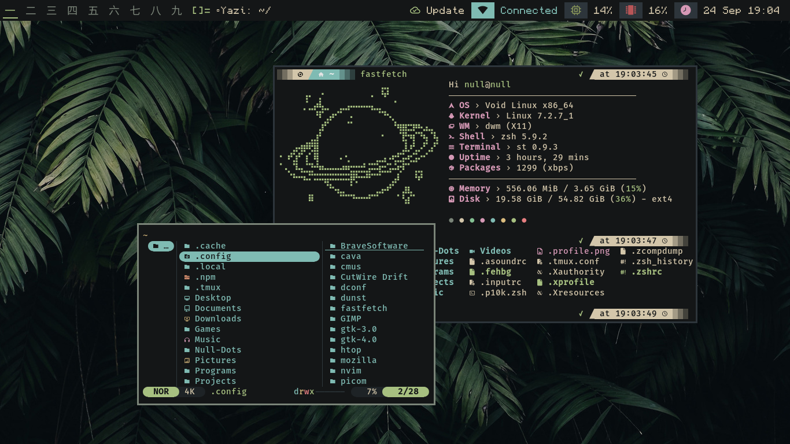
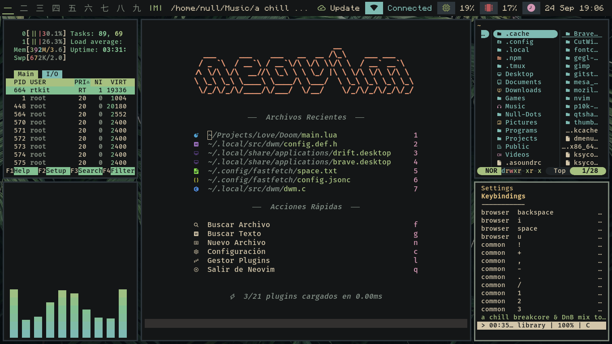
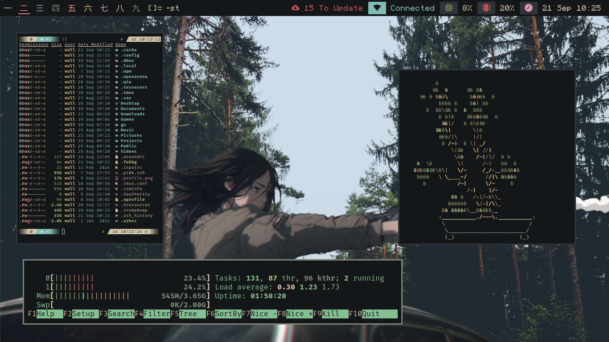
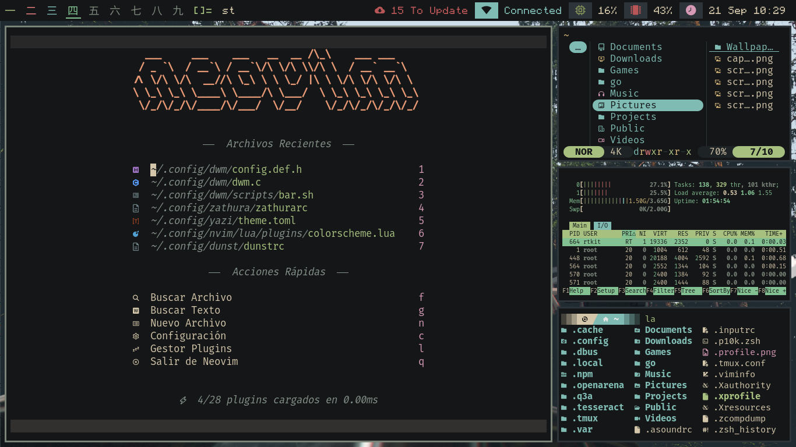

# Null Dotfiles

Mi entorno personal en **Void Linux**, diseñado bajo una filosofía de **minimalismo justo**: máxima velocidad de respuesta, bajo consumo de recursos, control total mediante el teclado y un flujo de trabajo centrado en la terminal y aplicaciones TUI.

> [!NOTE]
> Este entorno utiliza una bifurcación personalizada de `dwm` llamada **ZenithWM**, junto con `st` compilado desde el código fuente y una paleta de colores **Everforest Dark Hard** modificada con fondo plano ultra oscuro (`#141617`).

---

## 👨‍💻 Sobre Mí

Soy **//Null** (SoyNULL), desarrollador y entusiasta de los sistemas Unix-like. Me apasiona entender cómo funcionan las cosas por debajo del capó: desde la gestión de procesos y compilación en C, hasta la automatización, optimización de sistemas modestos y diseño de interfaces basadas en texto. 

Este repositorio documenta mi configuración diaria, construida pieza por pieza para evitar dependencias innecesarias y mantener un sistema ligero, predecible y completamente adaptado a mi forma de trabajar.

---

## 📷 Previews

| Vista Principal | Flujo de Desarrollo |
| :---: | :---: |
|  |  |

| Aplicaciones TUI | Layouts |
| :---: | :---: |
|  |  |

---

## 🛠️ System & Tools

| Componente | Selección | Notas / Detalles |
| :--- | :--- | :--- |
| **OS** | Void Linux (`x86_64`) | Rolling release independiente sin `systemd` |
| **Init System** | `runit` | Gestión de servicios rápida y minimalista |
| **Session / Audio** | `seatd` + `PipeWire` | Sin `elogind` ni PulseAudio tradicional |
| **Window Manager** | `dwm` (**ZenithWM**) | Parcheado y compilado desde fuente en C |
| **Compositor** | `picom` | Backend `xrender` (sin blur ni animaciones pesadas) |
| **Terminal** | `st` (Simple Terminal) | Con soporte para parches, ligaduras y `tmux` |
| **Shell** | `zsh` | Configurado con `Powerlevel10k` y plugins ligeros |
| **Editor** | `Neovim` | Configuración modular en Lua (`lazy.nvim`) |
| **File Manager** | `Yazi` | Navegador TUI rápido con previsualización |
| **Colorscheme** | `Everforest` (Custom) | Paleta oscura con fondo base `#141617` |
| **Tipografía** | `FiraCode` / `JetBrainsMono` | Con iconos de Nerd Fonts y numerales japoneses (`一`–`九`) |

---

## 🧰 Software & Aplicaciones Instaladas

Lista de las herramientas principales que componen el ecosistema diario:

### Sistema & Utilidades CLI/TUI
- **Terminal & Multiplexor:** `st` + `tmux` (con sesión persistente y *scratchpad* flotante).
- **Gestor de Archivos:** [Yazi](https://github.com/sxyazi/yazi) (acompañado de `fzf`, `zoxide`, `eza` y `bat`).
- **Editor de Código:** [Neovim](https://neovim.io/) (con LSP, Treesitter y autocompletado rápido).
- **Reproductor de Música:** `cmus` / `mpd` (controlado íntegramente desde consola).
- **Monitor & Info del Sistema:** `fastfetch` y utilidades propias en C.
- **Agenda & Tareas:** `calcurse` para organización en terminal.

### Entorno Gráfico (X11)
- **Lanzador de Aplicaciones:** `rofi` / `dmenu` (estilizados con la paleta del sistema).
- **Notificaciones:** `dunst` (minimalista con barras de progreso para volumen y brillo).
- **Navegador Web:** `Brave` / `Firefox` (con tema oscuro personalizado).
- **Visualizador de Documentos:** `Zathura` (control tipo Vim para PDFs y libros técnicos).
- **Capturas de Pantalla:** `maim` + `slop` (selección de área y copiado directo al portapapeles con `xclip`).
- **Control de Temperatura de Color:** `redshift` para sesiones nocturnas.

---

## 📂 Estructura de las Dotfiles

El repositorio está organizado de manera modular para facilitar la inspección de cada componente antes de aplicarlo:

```text
.dotfiles/
├── assets/                 # Capturas de pantalla y recursos visuales del README
├── configs/                # Configuraciones destinadas a ~/.config/
│   ├── dunst/              # Estilo y reglas del demonio de notificaciones
│   ├── fastfetch/          # Diseño de información del sistema en terminal
│   ├── nvim/               # Configuración completa de Neovim en Lua
│   ├── picom/              # Configuración del compositor X11
│   ├── redshift/           # Ajustes de temperatura de color de pantalla
│   ├── yazi/               # Keybindings y tema del gestor de archivos
│   ├── zsh_plugins/        # Plugins locales para Zsh
│   └── zathura/            # Tema oscuro y atajos del lector PDF
├── Pictures/
│   └── Wallpapers/         # Colección de fondos de pantalla minimalistas
├── local/
│   ├── share/
│   │   └── fonts/          # Fuentes parcheadas (Nerd Fonts)
│   └── src/                # Código fuente en C listo para compilar
│       ├── dwm/            # Fork personalizado ZenithWM (config.def.h + parches)
│       └── st/             # Simple Terminal personalizado (config.def.h)
├── .tmux/                  # Scripts y plugins de tmux
├── .p10k.zsh               # Configuración del prompt Powerlevel10k
├── .tmux.conf              # Atajos y barra de estado de tmux
├── .xprofile               # Variables de entorno e inicio de demonios X11
├── .Xresources             # Definición global de colores y fuentes X11
├── .zshrc                  # Alias, funciones y configuración de Zsh
└── README.md               # Documentación del proyecto
